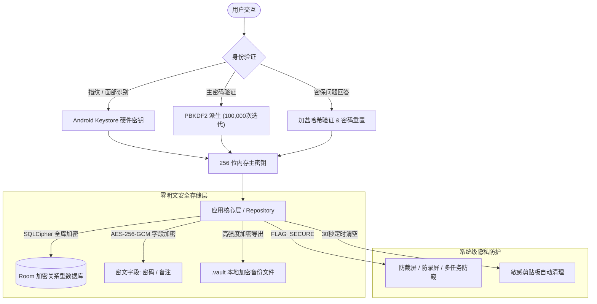

# KeyFortress (轻量级个人离线密码管家)

<p align="center">
  
  
  
  
  
  
</p>

> **安全 · 离线 · 纯粹**  
> 一款专为个人打造的**离线优先、高安全性、极简交互、流畅丝滑**的 Android 本地密码管理工具。无任何网络权限，零明文落盘，守护您的每一条数字身份资产。

---

## ✨ 核心原则与底层安全架构

KeyFortress 将安全性作为产品的生命线，严格贯彻底层原生防御机制：

### 1. 🛡️ 绝对离线保护 (Zero-Network Principle)
* `AndroidManifest.xml` 中**严禁声明** `android.permission.INTERNET` 权限。
* 无任何第三方统计、分析、广告或网络上传 SDK，从底层彻底根除云端泄露与网络侧黑客攻击风险。

### 2. 🔐 零明文落盘 (Zero-Plaintext Architecture)
* **密钥派生 (PBKDF2)**：用户设置的高强度主密码结合随机盐值（Salt），通过 `PBKDF2WithHmacSHA256` 算法经过 **100,000 次**哈希迭代，派生出 256 位加密主密钥。
* **全库与字段强加密**：底层持久化采用 **SQLCipher** 实现 Room 数据库全库高强度加密；敏感字段（密码、备注）同时采用 **AES-256-GCM** 双重防护。
* **硬件级密钥托管**：利用 **Android Keystore** 系统生成硬件隔离对称密钥，与指纹/面部识别绑定，Root 环境亦无法直接提取密钥文件。

### 3. 👁️ 防截屏、防录屏与多任务防窥 (Screen Security)
* 全局窗口注入 `WindowManager.LayoutParams.FLAG_SECURE` 安全标记：
  * 系统级阻止截屏与录屏，截屏时提示“受保护内容”；
  * 在多任务切换视图（最近任务列表）中，应用窗口自动模糊遮挡或变黑，彻底杜绝旁人窥屏。

### 4. 📋 剪贴板隐私自动清理 (Clipboard Hygiene)
* **Android 13+ 敏感屏蔽**：复制密码时自动注入 `ClipDescription.EXTRA_IS_SENSITIVE` 标记，屏蔽系统前台弹出密码明文气泡预览；
* **30 秒定时清除**：复制密码后启动后台安全计时器，30 秒后自动清空系统剪贴板，防止其他 App 后台偷取。

### 5. 🔑 密保防忘安全重置 (Zero-Knowledge Password Recovery)
* 首次使用可自选或自定义安全密保问题（如“母亲姓名”、“高中学校”等）；
* 密保答案采用安全加盐哈希（SHA-256 + Salt）离线存储；即使遗忘主密码，只要答对密保问题，即可重置主密码并无损重新派生数据密钥。

---

## 📱 核心功能特性

- ⚡ **闪电秒级解锁**：支持 BiometricPrompt 系统级指纹/面部识别快速进入，同时支持主密码无缝回退。
- ⚡ **极致流畅度架构**：
  - **列表零解密策略**：列表浏览与实时搜索时绕过高耗能的 AES-256 密文解密，毫秒级响应，数千条记录满帧 120 FPS 顺滑滑动；
  - **精准按需解密**：点击“复制密码”或进入详情页时才在协程中按需单条瞬时解密。
- 🪄 **智能文本批量导入**：
  - 支持从微信记录、Excel/CSV 表格、备忘录等任意杂乱文本中一键粘贴；
  - 异步后台协程智能识别平台、账号、密码及备注，自动推导所属分类；
  - 极轻量卡片预览与实时编辑微调，单次 SQLite 事务秒级批量入库。
- 🗂️ **动态自定义分类 & 防丢失迁移**：
  - 支持自主添加、重命名与删除自定义分类标签；
  - 若删除某个分类，该分类下的账号**自动安全降级转移至默认分组（其它）**，绝不丢失任何数据。
- 🗑️ **主页批量管理与多选删除**：
  - 长按任意卡片或点击顶部批量图标进入多选模式；
  - 支持一键全选/取消全选，二次弹窗防误触批量清除。
- 🎲 **高强度随机密码发生器**：
  - 8-32 位可调长度，自由组合大写字母、小写字母、数字及特殊符号，支持排除易混淆字符（`0/O`, `1/l/I`）。
- 🔍 **智能检索与拼音首字母匹配**：
  - 模糊实时关键字检索，内置拼音分词索引（输入 `wx` 即可秒搜“微信”）。
- 💾 **高强度离线加密备份与恢复**：
  - 支持将整个密码库导出为密码保护的 `.vault` 加密文件；
  - 兼容本地存储、系统下载目录与系统分享面板，换机或重装无忧。
- 🕰️ **密码修改历史记录**：
  - 修改密码时自动记录最近 3 次的历史旧密码与修改时间，防止修改后遗忘。

---

## 🏗️ 系统架构设计



---

## 🛠️ 技术选型栈

| 层次 | 选型技术 | 说明 |
|---|---|---|
| **语言** | Kotlin 2.0.21 | 现代、安全、表达力强的 Android 开发语言 |
| **UI 框架** | Jetpack Compose (Material 3) | 全新声明式 UI 体系，原生自适应深色/浅色模式 |
| **架构** | MVVM + UDF + Flow | 单向数据流设计，高内聚低耦合响应式架构 |
| **加密数据库** | Room 2.6.1 + SQLCipher 4.5.4 | 行业标杆级 SQLite 全库二进制加密 |
| **认证与安全** | AndroidX Biometric + Crypto | 生物特征识别、安全偏好与 Keystore 硬件交互 |
| **备份管理** | Android SAF (Storage Access Framework) | 规范、安全的沙盒文件读写与系统共享通道 |

---

## 📂 项目结构指南

```
KeyFortress/
├── app/
│   ├── build.gradle.kts
│   ├── proguard-rules.pro
│   └── src/
│       ├── main/
│       │   ├── AndroidManifest.xml
│       │   ├── java/com/keyfortress/app/
│       │   │   ├── KeyFortressApplication.kt     // 生命周期全局监听与自动锁定计时
│       │   │   ├── MainActivity.kt               // FLAG_SECURE 防截屏注入与 Compose 承载
│       │   │   ├── data/
│       │   │   │   ├── model/                    // 数据模型 (分类、备份模型、密码强度)
│       │   │   │   ├── entity/                   // Room 数据表实体 (Account, History, Category)
│       │   │   │   ├── dao/                      // 数据库访问接口 (批量优化)
│       │   │   │   ├── database/                 // SQLCipher 数据库配置与平滑迁移 (AppDatabase)
│       │   │   │   └── repository/               // 统一仓库层 (内存缓存与零解密提速)
│       │   │   ├── security/
│       │   │   │   ├── CryptoManager.kt          // PBKDF2 密钥派生与 AES-256-GCM 加解密核心
│       │   │   │   ├── KeyStoreManager.kt        // Android Keystore 硬件生物认证密钥
│       │   │   │   ├── BiometricAuthHelper.kt    // 系统生物识别弹窗调度
│       │   │   │   ├── ClipboardHelper.kt        // 30 秒安全剪贴板定时清空机制
│       │   │   │   ├── AppLockManager.kt         // 保险库锁屏会话与内存安全管理
│       │   │   │   └── PasswordGenerator.kt      // 随机强密码生成算法
│       │   │   ├── util/
│       │   │   │   ├── SmartTextParser.kt        // 智能文本正则分词与分类推导引擎
│       │   │   │   ├── PinyinHelper.kt           // 汉字拼音首字母索引 (wx -> 微信)
│       │   │   │   ├── AccountMasker.kt          // 账号脱敏遮罩处理 (138****1234)
│       │   │   │   ├── BackupFileManager.kt      // 本地加密备份文件导出与分享管理
│       │   │   │   └── TimeFormatter.kt          // 友好时间展示格式化
│       │   │   └── ui/
│       │   │       ├── theme/                    // Fortress 现代深色/浅色配色主题
│       │   │       ├── components/               // 密码卡片、分类管理、智能导入弹窗等复用组件
│       │   │       ├── navigation/               // Compose 页面导航控制器
│       │   │       ├── lock/                     // 首次初始化与解锁登录页面
│       │   │       ├── home/                     // 主页列表、搜索、多选批量管理
│       │   │       ├── detail/                   // 详情展示与历史密码追溯
│       │   │       ├── edit/                     // 新增与编辑账号
│       │   │       └── settings/                 // 密保问题、数据备份与安全设置
│       │   └── res/                              // 矢量图标、主题资源配置
│       └── test/                                 // 单元测试 (加解密、解析器、密保、拼音)
├── gradle/wrapper/                               // 标准跨平台 Gradle Wrapper 配置文件
├── build.gradle.kts                              // 根工程构建配置
├── settings.gradle.kts                           // 模块设置
└── README.md                                     // 项目完整说明文档
```

---

## ⚡ 快速编译与构建

### 环境要求
* **JDK**：Java 17 或以上
* **Android SDK**：Compile SDK 35，Min SDK 26 (Android 8.0+)
* **Gradle**：8.11.1 (已内置 Wrapper)

### 本地编译指令

```powershell
# 1. 克隆代码仓库
git clone https://github.com/CGW-Dev1/KeyFortress.git
cd KeyFortress

# 2. 执行完整单元测试
./gradlew testDebugUnitTest

# 3. 构建发布 Debug APK
./gradlew assembleDebug
```

构建输出路径位于：  
`app/build/outputs/apk/debug/app-debug.apk`

---

## 📥 下载安装

最新打包的独立 APK 安装包已发布于 GitHub Releases：
👉 **[点击前往 GitHub Releases 下载最新 APK 安装包](https://github.com/CGW-Dev1/KeyFortress/releases)**

---

## 📄 开源许可证

本项目采用 **Apache License 2.0** 许可证开源。请尽情自由查阅源码、学习与离线使用。
